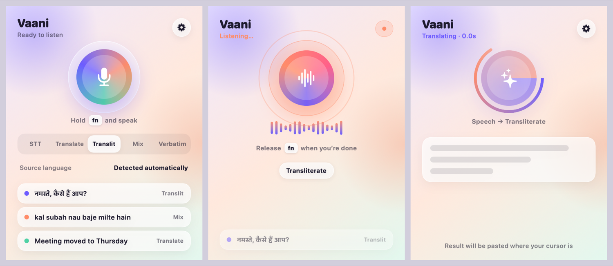

# Vaani — Speak in Any Indian Language, Type Anywhere

[](https://github.com/jayjpatel9717/Vaani-translator/releases)
[](LICENSE)
[](https://github.com/jayjpatel9717/Vaani-translator/releases/latest)
[](https://swift.org)

A tiny macOS menubar app that turns your voice into text — in 23 Indian languages. Speak Hindi into Slack, Tamil into VS Code, Gujarati into Gmail. Text auto-pastes at your cursor.

> **Hold to speak. Release to translate. Done.**



---

## Table of Contents

- [Install](#install)
- [Quick Start](#quick-start)
- [Features](#features)
- [Translation Modes](#translation-modes)
- [Keyboard Shortcuts](#keyboard-shortcuts)
- [Use Cases](#use-cases)
- [Requirements](#requirements)
- [Project Structure](#project-structure)
- [Security](#security)
- [Built With](#built-with)
- [Troubleshooting](#troubleshooting)
- [Contributing](#contributing)
- [Changelog](#changelog)
- [License](#license)

---

## Install

### Homebrew (Recommended)

```bash
brew tap jayjpatel9717/vaani
brew install --cask vaani
```

No Gatekeeper warnings. Updates with `brew upgrade`. Clean uninstall with `brew uninstall --cask vaani`.

### Download DMG

Grab the latest `.dmg` from [Releases](https://github.com/jayjpatel9717/Vaani-translator/releases/latest). Right-click the Quick Install script and choose **Open** (macOS 15+ blocks a plain double-click on unsigned scripts), then click Install.

### Build from Source

```bash
git clone https://github.com/jayjpatel9717/Vaani-translator.git
cd Vaani-translator
./build.sh && open Vaani.app
```

Requires Xcode Command Line Tools and Swift 5.9+.

---

## Quick Start

1. **Launch** — a mic icon appears in your menubar and the welcome checklist opens
2. **Add API key** — paste your [Sarvam AI](https://dashboard.sarvam.ai/key-management) key; Vaani checks it live ("Key OK")
3. **Allow Microphone and Accessibility** — one button each, with a green tick when done
4. **Speak** — hold `fn` (globe key) or `Ctrl+Space`, say something, release — a status pill shows *Listening → Translating → Pasted* and the text lands at your cursor

That's it. No windows to manage, no app switching. Works from any app.

---

## Features

### Core

- **23 Indian languages** — Hindi, Tamil, Telugu, Bengali, Marathi, Gujarati, Kannada, Malayalam, Odia, Punjabi, Assamese, Urdu, Kashmiri, Konkani, Maithili, Manipuri, Nepali, Santali, Sindhi, Dogri, Bodo, Sanskrit, and English
- **5 translation modes** — Translate, Transcribe, Transliterate, Code-mix, Verbatim
- **Auto source detection** — speak any language, Vaani detects it automatically
- **Unlimited recording** — speak as long as you want, audio is chunked and processed in parallel
- **Direct translation** — source language to target directly, no English middleman
- **Global hotkeys** — `fn` (globe key) enabled by default, or `Ctrl+Space`, works from any app
- **Smart auto-paste** — translated text inserts at cursor via Accessibility API with multi-strategy fallback
- **Translation history** — last 5 results with quick copy buttons

### Experience

- **Soft Glass interface** — mesh-gradient popover, frosted cards, a gradient orb that pulses while you speak and spins while translating
- **Floating status pill** — Listening / Translating / Pasted / error feedback on whatever screen you are working on, independent of the menubar
- **First-run checklist** — key, microphone, accessibility and a try-it step, each with a live tick
- **Clear failure states** — out-of-credits, invalid key and "nothing heard" are explained in place with the right next action
- **Dark & Light theme** — follows system appearance, or pick in Settings
- **Fast turnaround** — connection opens when you press the key, audio is recorded straight at 16 kHz, no conversion step after release
- **Native SwiftUI** — no Electron, no web views, minimal memory footprint

### Security

- **API key in macOS Keychain** — never stored in plaintext
- **Audio in protected directory** — `chmod 700`, deleted after processing
- **TLS certificate validation** — pinning-ready infrastructure
- **Client-side rate limiting** — 30 requests per minute
- **Sanitized errors** — no server details leaked to UI
- **No telemetry** — zero data collection, fully offline except API calls

---

## Translation Modes

| Mode | What it does | You say (Hindi) | You get |
|------|-------------|-----------------|---------|
| **Transcribe** | Speech to text in original script | "mera phone number hai..." | मेरा फोन नंबर है 9840950950 |
| **Translate** | Speech to another language | "mera phone number hai..." | My phone number is 9840950950 |
| **Transliterate** | Speech to English letters (default) | "mera phone number hai..." | mera phone number hai 9840950950 |
| **Code-mix** | English stays English, rest in native | "mera phone number hai..." | मेरा phone number है 9840950950 |
| **Verbatim** | Exact words, fillers preserved | "mera phone number hai..." | मेरा फोन नंबर है नौ आठ चार zero... |

Default mode is **Transliterate** — great for chatting in Hinglish.

---

## Keyboard Shortcuts

| Shortcut | Action |
|----------|--------|
| `fn` (globe key) | Hold to record, release to process (default) |
| `Ctrl+Space` | Hold to record, release to process |

Customize your shortcut in Settings > Shortcuts.

---

## Use Cases

- **Developers** — speak Hindi/Tamil/Telugu into Claude Code, VS Code, or any IDE
- **Chat** — type in WhatsApp, Telegram, Slack in any Indian language
- **Email** — compose in your language, auto-types at cursor
- **Notes** — meetings, classes, quick reminders in your mother tongue
- **Social media** — post in regional languages without a keyboard switch

---

## Requirements

- macOS 13.0 (Ventura) or later
- [Sarvam AI API key](https://dashboard.sarvam.ai/key-management) (free tier available)

### Permissions

| Permission | Why |
|-----------|-----|
| **Microphone** | Record your voice |
| **Accessibility** | Auto-paste at cursor and global hotkey monitoring |

Builds are signed with a stable local certificate (`scripts/make-signing-cert.sh`), so these grants survive updates. If you build from source without running that script once, macOS asks again after every build. To reset by hand:

```bash
tccutil reset Accessibility com.vaani.app
```

When the keychain asks whether Vaani may use its saved key, choose **Always Allow**.

---

## Project Structure

```
Sources/
  main.swift                     # App entry, menubar, hotkeys
  Models/
    Language.swift                # 23 languages + 5 modes
    TranslationResult.swift      # API response models
  ViewModels/
    TranslatorViewModel.swift    # State, recording, API calls, rate limiting
  Views/
    MainView.swift               # Popover: ready / listening / translating / result / error states
    SetupView.swift              # First-run checklist
    SettingsView.swift           # Settings (API key, shortcuts, appearance)
    StatusHUD.swift              # Floating status pill (NSPanel + SwiftUI)
    Glass.swift                  # Shared Soft Glass components (orb, cards, pills, segmented)
  Services/
    AudioRecorder.swift          # AVAudioEngine recording
    SaarasAPIClient.swift        # Sarvam AI API client with TLS validation
    KeychainManager.swift        # macOS Keychain storage
    PasteboardManager.swift      # Multi-strategy auto-paste
    FnKeyMonitor.swift           # CGEventTap fn key listener
  Theme/
    AppTheme.swift               # Soft Glass design tokens (light/dark)
  Utils/
    AudioChunker.swift           # Audio chunking (+ afconvert fallback)
Vendor/KeyboardShortcuts/        # sindresorhus/KeyboardShortcuts 1.14.0, resource-bundle lookup patched
Tests/
  BundleCheck/run.sh             # Regression check for the resource-bundle crash
  snapshots.sh                   # Renders every screen to PNG (VAANI_SNAPSHOT_DIR)
scripts/make-signing-cert.sh     # One-time local signing identity
```

---

## Security

- API keys stored in macOS Keychain (not plaintext, not UserDefaults)
- Audio files in `~/Library/Application Support/com.vaani.app/recordings` with `chmod 700`
- Audio deleted immediately after API processing
- TLS certificate validation with pinning-ready infrastructure
- Client-side rate limiting (30 requests/minute)
- Thread-safe fn key state management with NSLock
- Sanitized error messages (no server response details exposed)
- No debug logging in release builds
- No telemetry or analytics

---

## Built With

- Swift 5.9 / SwiftUI
- AVFoundation
- [KeyboardShortcuts](https://github.com/sindresorhus/KeyboardShortcuts) v1.14.0 — by Sindre Sorhus
- [KeychainAccess](https://github.com/kishikawakatsumi/KeychainAccess) v4.2.2 — by kishikawakatsumi
- [Sarvam AI](https://sarvam.ai) — Saaras v3 (STT) + Sarvam Translate v1

---

## Troubleshooting

See [TROUBLESHOOTING.md](TROUBLESHOOTING.md) for common issues:

- macOS security warnings (Gatekeeper)
- Microphone or Accessibility permissions
- Hotkeys not responding
- "Translation failed" / out of credits
- Reading Vaani's log
- Build errors on Intel Macs

---

## Contributing

Contributions are welcome! Please see the [issue templates](.github/ISSUE_TEMPLATE) for reporting bugs or requesting features.

1. Fork the repo
2. Create your branch (`git checkout -b feature/amazing-feature`)
3. Commit your changes
4. Push to the branch (`git push origin feature/amazing-feature`)
5. Open a Pull Request

---

## Changelog

See [CHANGELOG.md](CHANGELOG.md) for release history.

---

## License

[MIT](LICENSE) — Jay Patel
